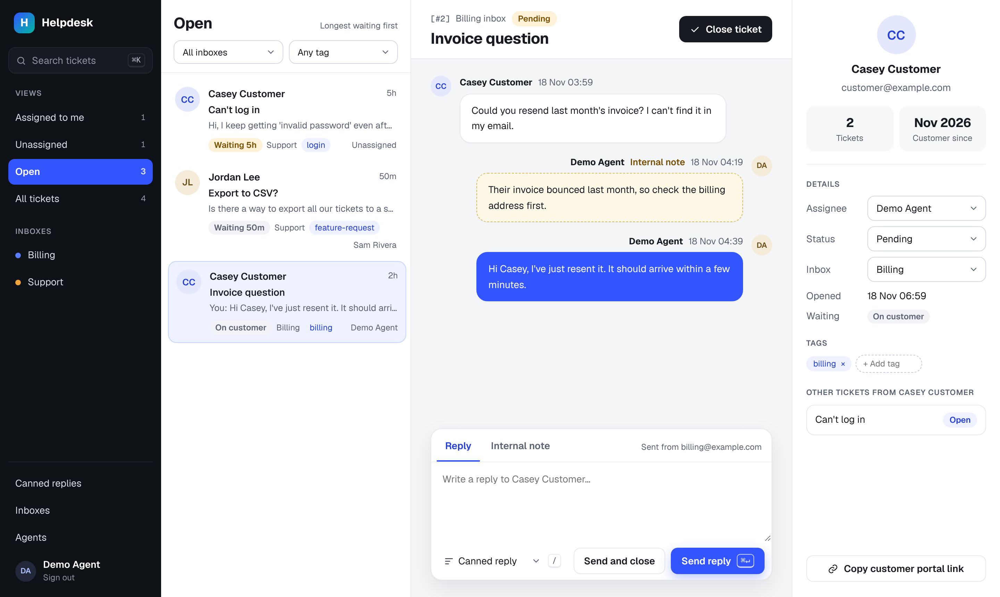

# Helpdesk

An open source, self-hosted helpdesk built with Rails 8. Customers email your support address, the
emails become tickets, and your team answers them from one shared inbox.



## Features

- **Shared inbox.** Email sent to your support address arrives through Action Mailbox and opens a
  ticket. When the customer replies, the reply joins the same ticket (matched by the `[#42]` tag in
  the subject or the email's `References` header).
- **Assignment.** Agents filter tickets by *Mine*, *Unassigned*, *Open* or *All*, and assign a ticket
  to themselves or a teammate. Tickets move between `open`, `pending` and `closed`.
- **Canned replies.** Save common answers and drop them into a reply from a menu.
- **Customer portal.** Every reply email links to a private page where the customer can read the
  whole conversation and answer from the browser. No customer accounts or passwords needed.

## Getting started

You need Ruby 3.3 or newer and SQLite.

```sh
git clone https://github.com/royalpriest/helpdesk.git
cd helpdesk
bin/setup          # installs gems, creates the database, loads demo data, starts the server
```

Open http://localhost:3000 and sign in as `agent@example.com` / `password`.

### Try the inbox locally

Rails ships a page for sending fake inbound email. With the server running, open
http://localhost:3000/rails/conductor/action_mailbox/inbound_emails/new, write an email to
`support@example.com`, and it shows up as a new ticket.

Agent replies are delivered by Active Job. In development you can see them in the log.

## Configuration

| Variable | What it does | Default |
| --- | --- | --- |
| `SUPPORT_EMAIL` | The address customers write to and replies come from | `support@example.com` |
| `APP_HOST` | Host used in links inside emails (production) | `example.com` |
| `ACTION_MAILBOX_INGRESS` | How inbound mail reaches the app: `relay`, `postmark`, `sendgrid`, `mailgun`, `mandrill` (production) | `relay` |
| `AUTO_CLOSE_AFTER_DAYS` | Close tickets waiting on the customer after this many days (`0` turns it off) | `7` |

See the [Action Mailbox guide](https://guides.rubyonrails.org/action_mailbox_basics.html) for setting
up your mail provider's ingress.

Create your first agent from the console:

```ruby
User.create!(name: "Your Name", email_address: "you@example.com", password: "a-long-password")
```

After that, invite teammates from the **Agents** page. They get an email with a link to choose
their password.

## How it fits together

| Piece | File |
| --- | --- |
| Incoming email to tickets | `app/mailboxes/support_mailbox.rb` |
| Ticket rules (status changes, replies) | `app/models/ticket.rb` |
| Reply email to the customer | `app/mailers/ticket_mailer.rb` |
| Agent screens | `app/controllers/tickets_controller.rb`, `app/views/tickets/` |
| Customer portal | `app/controllers/portal/` |
| Canned reply picker | `app/javascript/controllers/canned_reply_controller.js` |

## Contributing

Contributions are welcome, and first-timers especially. Issues labeled
[good first issue](https://github.com/royalpriest/helpdesk/labels/good%20first%20issue) are a good
place to start. See [CONTRIBUTING.md](CONTRIBUTING.md) and the [roadmap](ROADMAP.md).

## License

MIT. See [LICENSE](LICENSE).
